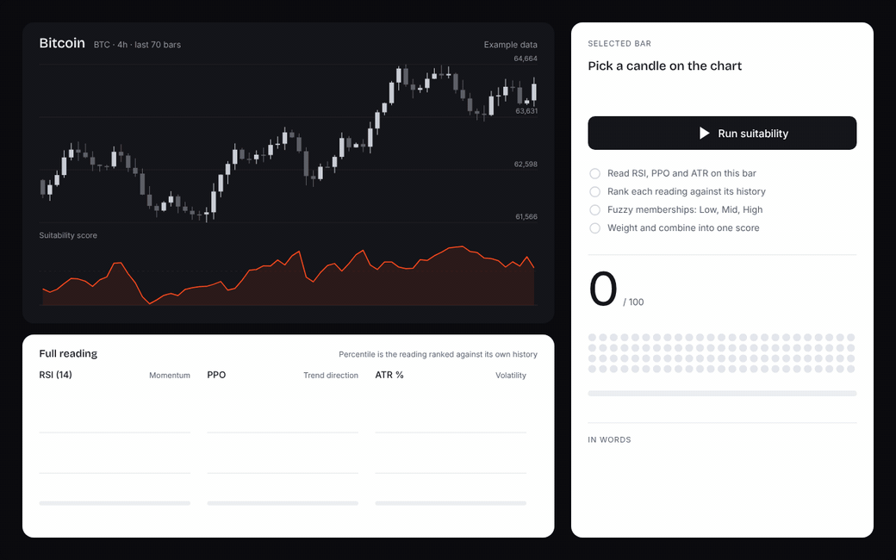

<div align="center">


<br>

**ptbn** (Perturbation) is a quantitative signal platform. It ingests market data, computes technical indicators, and runs a fuzzy inference engine to produce a suitability score for each asset, with every step of the reasoning exposed.

<br>

[Overview](#overview) &nbsp;·&nbsp; [Explainability](#explainability) &nbsp;·&nbsp; [Architecture](#architecture) &nbsp;·&nbsp; [Data flow](#data-flow) &nbsp;·&nbsp; [Inference](#inference) &nbsp;·&nbsp; [Data model](#data-model) &nbsp;·&nbsp; [Quickstart](#quickstart) &nbsp;·&nbsp; [Roadmap](#roadmap)

</div>

<br>

## Overview

Most signal tools hand you a verdict. ptbn is built around the opposite idea: **data, then evidence, then interpretation, then conclusion**, with each layer inspectable.

- **Multi-market ingestion.** Crypto from Binance, equities from Polygon, and Indian indices and equities (NSE / BSE) through a dedicated connector, all normalized into a single candle schema.
- **Indicator pipeline.** Ten technical indicators are computed on a schedule and stored alongside derived, human-readable signal states (overbought, crossover, volatility regime).
- **Fuzzy inference.** Membership functions over RSI, PPO and ATR% feed a rule base that aggregates into one suitability score. Per-indicator memberships are retained, so a score can be traced back to what drove it.
- **Typed API.** A FastAPI service with Pydantic request and response models, JWT authentication and OAuth.

The name comes from perturbation theory. Each indicator is a weak signal, a small perturbation to a baseline, and the score is what accumulates when they are summed.

<br>

## Explainability

<div align="center">

</div>

<br>

Pick a bar, run suitability, and the score arrives with its working shown.

1. **Read** RSI, PPO and ATR on the selected bar.
2. **Rank** each reading against its own history, as a percentile.
3. **Fuzzify** each percentile into Low, Mid and High memberships.
4. **Combine** the memberships into one score, with every indicator's contribution reported in points.
5. **Describe** the result in plain language. The narration explains a number that has already been computed; it never predicts.

The recording uses synthetic candles and illustrative values.

<br>

## Architecture

<div align="center">

</div>

<br>

| Layer | Responsibility |
| :-- | :-- |
| **Providers** | Polygon, Binance, and NSE / BSE via `yfinance` (`^NSEI`, `^BSESN`). |
| **Ingestion** | `BaseConnector` defines the pipeline; `MarketOrchestrator` coordinates providers. |
| **Storage** | TimescaleDB hypertables for candles, indicator values, indicator signals and suitability scores. |
| **Compute** | Celery worker and beat. Indicators, fuzzy engine and score computation run as chained tasks. |
| **Serving** | Async FastAPI over PostgreSQL. Typed routes, JWT + OAuth, user and portfolio endpoints. |

The stack is fully containerized with Docker Compose: TimescaleDB, Redis, FastAPI, a Celery worker and Celery beat. Market data is fetched every 30 seconds by Celery beat, with Redis as the broker. Because Celery is synchronous by default, the worker opens its own async database session for each task.

<br>

## Data flow

<div align="center">

</div>

<br>

Every provider goes through the same five-step `BaseConnector` pipeline, so adding a new source means implementing the provider-specific steps and nothing else.

1. **Plan** which symbols and time range to request.
2. **Fetch** from the provider API.
3. **Normalize** the payload into the common OHLCV candle schema (asset, timeframe, OHLCV, timestamp).
4. **Validate** the normalized rows.
5. **Store** them in the `market_price_candles` hypertable.

Indicator computation is chained directly onto candle ingestion, so new candles flow through to updated indicators and suitability scores without manual intervention.

<br>

## Inference

<div align="center">

</div>

<br>

The suitability score is produced by a fuzzy inference layer rather than a black-box model.

- **Fuzzification.** Each input (RSI, PPO, ATR%) is mapped onto overlapping trapezoidal and triangular membership functions, so a reading belongs partly to several states instead of snapping to one.
- **Rules.** A rule base combines the memberships across indicators: momentum, trend and volatility.
- **Aggregation.** Rule outputs are combined and defuzzified into a single suitability score.
- **Explainability.** Per-indicator membership degrees are exposed alongside the aggregate, so the score decomposes into the points each indicator contributed.

The membership shapes in the diagram are illustrative. Calibrated boundaries come from quantile-based tuning against historical data.

<br>

## Data model

| Table | Contents |
| :-- | :-- |
| `market_price_candles` | Normalized OHLCV candles for all crypto providers. Hypertable. |
| `indicator_values` | Raw numeric indicator outputs, keyed on `(asset_id, timestamp)`. Hypertable. |
| `indicator_signals` | Derived status columns (overbought / oversold, crossovers, slopes), keyed on `(asset_id, timestamp)`. Hypertable. |
| `suitability_scores` | Output of the fuzzy engine per asset and timestamp. |
| `marketinstruments`, `nsepricecandles`, `market_breadth` | NSE-specific instruments, candles and breadth data. |
| `users`, `verification_tokens` | Accounts and email verification. |

Status columns are stored as `varchar` with `CHECK` constraints rather than native Postgres enums, which keeps schema migrations simple. Crypto assets (`assets` / `asset_id`) and NSE equities (`instruments` / `instrument_id`) are separate universes; the indicator pipeline currently covers crypto, with a parallel set of tables planned for NSE.

<br>

## Technology

| | |
| :-- | :-- |
| **API** | FastAPI, Pydantic, async SQLAlchemy |
| **Data** | PostgreSQL with TimescaleDB, Alembic migrations |
| **Workers** | Celery, Celery beat, Redis |
| **Analysis** | pandas, NumPy, scikit-learn |
| **Auth** | JWT (stateless), OAuth, email verification |
| **Tooling** | Poetry, Docker Compose |

<br>

## Quickstart

Requirements: Docker with Compose, and Git.

```bash
git clone https://github.com/ron-sen/ptbn.git
cd ptbn

cp .env.example .env        # fill in provider keys and secrets
docker compose up -d        # TimescaleDB, Redis, API, worker, beat
```

Code changes are picked up through volume mounts, so most edits do not need a rebuild. Use `docker compose up -d --build` after changing dependencies.

> **Note.** Never commit `.env`. Provider API keys and signing secrets belong in your local environment only.

<br>

## Repository layout

```text
Backend/
├── app/
│   └── ml/
│       └── fuzzy/
│           └── engine.py        # fuzzy inference and suitability score
└── scripts/
    ├── ops/                     # operational jobs, e.g. backfill_gaps.py
    ├── smoke/                   # end-to-end smoke checks
    └── research/                # studies and experiments
```

<br>

## Roadmap

| Status | Item |
| :-- | :-- |
| Shipped | Polygon, Binance and NSE connectors on a shared `BaseConnector` pipeline |
| Shipped | Ten-indicator pipeline with derived signals, chained to ingestion on a Celery schedule |
| Shipped | Fuzzy suitability engine over RSI, PPO and ATR |
| Shipped | Auth: sign up, email verification, JWT, OAuth |
| In progress | Deployment at `ptbn.io` |
| In progress | Backtesting framework with walk-forward evaluation |
| Planned | LLM insight layer: natural-language narration of already-computed signals, never predictions |
| Planned | Additional candle-data connectors |
| Research | Full ten-indicator fuzzy model, three tuning methods (quantile, Gaussian, Fuzzy C-Means) and hierarchical Mamdani inference, each backtested before promotion |

<br>

## Research background

The fuzzy layer builds on published work on fuzzy logic for technical analysis, including Darmawan et al. (2024) as the primary validated reference, with Fuzzy C-Means as the baseline clustering method, and Davies et al. (2022) on Type-2 fuzzy logic for NSE markets.

<br>

## Disclaimer

ptbn is a research and engineering project. Its outputs are analytical signals, not financial advice, and nothing here is an invitation to trade.

<br>

<div align="center">

**ptbn** &nbsp;·&nbsp; built by [Ronsen](https://github.com/ron-sen)

</div>
